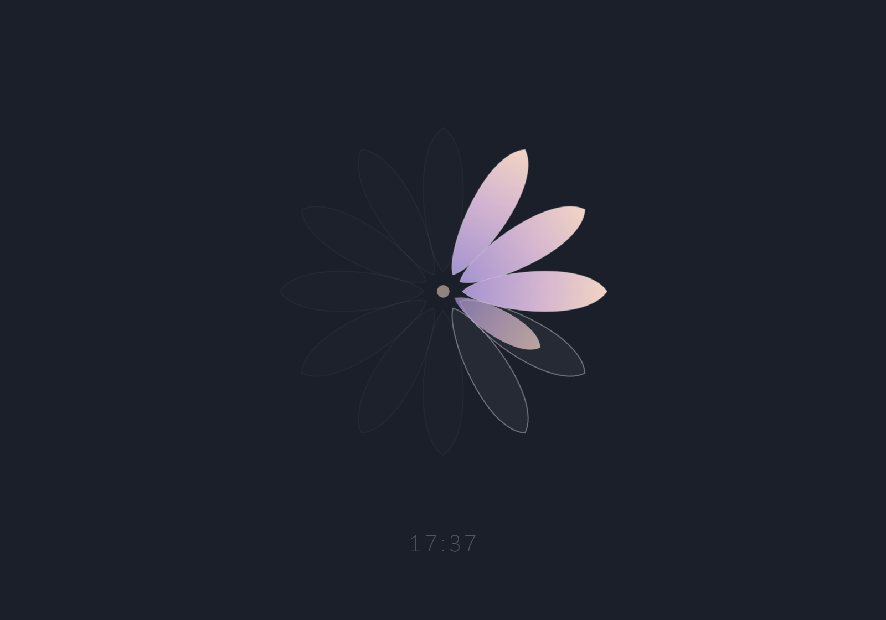

# Flower

> Me: Hey Mitch, what should we call this thing?\
> Mitch: What does it do?\
> Me: It helps me get into flow.\
> Mitch: Well that's a flower. I'm going on break.

*If you know, you know.*

A quiet focus timer in a single HTML file.

**[Open it](https://benjaminbrumfield.github.io/flower/)**, or download [`index.html`](index.html) and open it locally.

## How it works

Twelve petals make an hour, five minutes each. Pick a length and that many petals light up, each folding back into the center as its five minutes pass.

## Controls

- Click a number to start.
- Click anywhere, or press Space, to pause and resume.
- Press Esc while paused to cancel.

## History

Sessions are saved in your browser and never leave your machine. The strip at the bottom shows the last 8 hours. **export** downloads everything as CSV.

## License

[MIT](LICENSE)
